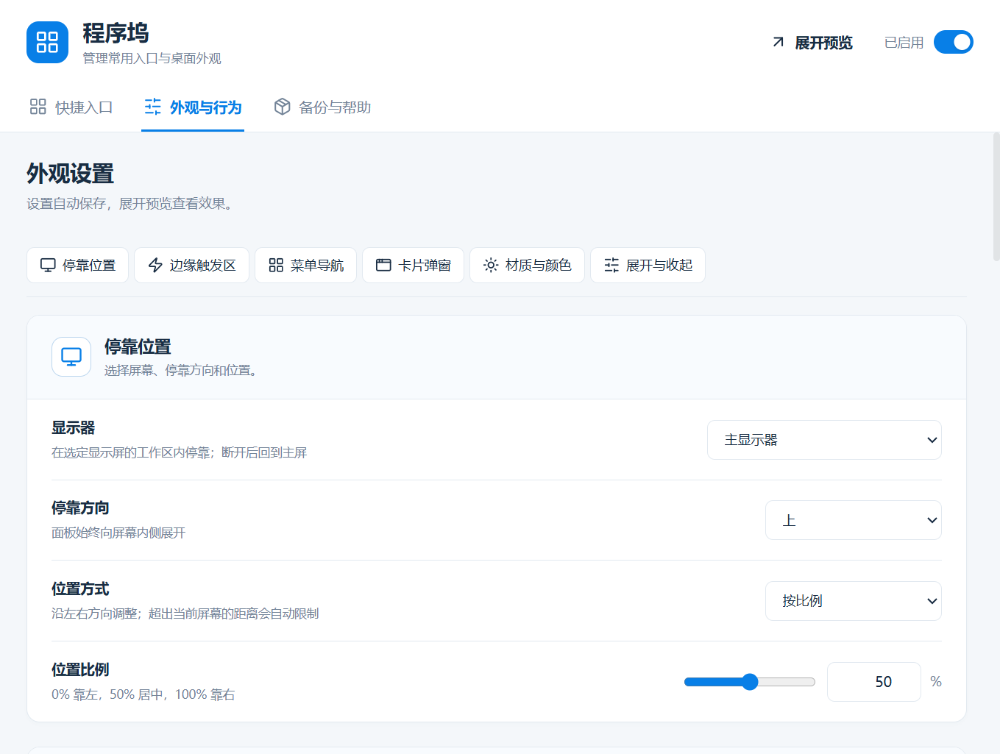

# 程序坞

把常用应用、文件、文件夹、网址和 ZTools 插件放到屏幕边缘。鼠标移过去展开，点击即可打开。

## 开始使用

1. 安装后，在 ZTools 输入 **程序坞设置**，添加分类和入口。也可以把应用、快捷方式、文件或文件夹拖进设置页。
2. 复制网址或本地文件后唤起 ZTools，选择 **添加到程序坞**。没有自动匹配时，粘贴到搜索框或直接输入这条指令。
3. 悬停屏幕边缘的触发条展开；也可以搜索 **程序坞** 或 **dock**。右键程序坞打开设置。

在插件管理中关闭本插件的“退出即结束”，让程序坞留在后台。需要随 ZTools 启动时，可开启宿主提供的“跟随启动”。

## 按习惯调整

- **整理入口**：分类和入口可拖动排序，空分类自动隐藏。网址支持获取网站图标，也可选择本地图片。
- **停靠位置**：上、下、左、右任选，按比例或距离定位。触发区可用细条、虫仔、蜗牛，或上传 PNG（不超过 2 MB）。
- **尺寸与外观**：菜单条、卡片弹窗分别设置宽高；点击“自动”恢复内容适配。卡片支持 50%～150% 整体缩放，菜单名称和入口名称可分别隐藏。
- **钉住与搜索**：图钉只固定菜单条，卡片仍随鼠标离开收起。图钉和搜索框都可在设置中开关，搜索默认关闭。
- **备份**：导出、导入 JSON，保存分类、入口、图片和外观。重置外观不会删除分类和入口；换电脑后，本地路径可能需要重新选择。

## 运行要求

仅支持 Windows，依赖 ZTools 运行。可在一个选定显示屏的工作区四边停靠，副屏断开后回到主屏。

云母、亚克力需要 Windows 11 22H2 或更新版本，其余系统使用纯色。背景不透明度调整底色浓度，系统模糊强度由 Windows 控制。

暂不支持全屏自动避让、多屏同时停靠、启动参数和自定义脚本；管理员窗口、UAC 安全桌面及独占全屏场景未保证兼容。添加插件入口需填写唯一插件名称和指令，同名插件无法区分。
